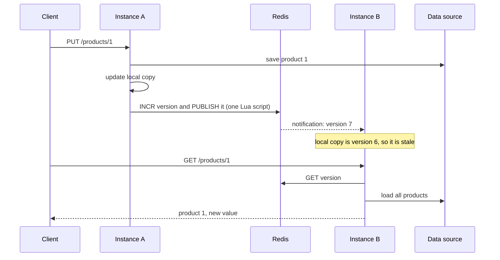

# Hybrid Distributed Cache

[](https://github.com/ihor-poliukhovych/HybridDistributedCache/actions/workflows/ci.yml)

An in-memory cache for .NET applications that run as several instances. Every instance keeps the
whole data set in its own memory. Redis stores only a version number and tells the instances when
to reload. The cached objects are never serialized.

Started in 2019, modernized in 2026: .NET 10, reworked synchronization, tests and CI.

## Why

Some data is read on almost every request and changes rarely: a product catalog, settings,
dictionaries. There are two common ways to cache it in a service with several instances:

- `IDistributedCache` (Redis): every read is a network call plus deserialization.
- `IMemoryCache`: reads are fast, but after a write the instances hold different data.

This project keeps reads in local memory, like `IMemoryCache`, and uses Redis only to agree on
when the data changed.

## How it works



- **Reads** come from memory. The version in Redis is checked at most once per
  `VersionCheckInterval` (10 seconds by default). Between checks a read does not leave the process.
- **Writes** (`SetAsync`, `RemoveAsync`, `InvalidateAsync`) update the local copy, increment the
  version and publish it on a Pub/Sub channel in one round trip.
- **Other instances** get the notification, mark their copy as stale and reload it on the next
  read. If a notification is lost, for example during a reconnect, the periodic version check
  catches the change.
- **One reload at a time.** Reloads, version checks and local writes run behind a `SemaphoreSlim`.
  A burst of reads after a change causes a single load from the data source.
- **Missed writes are detected.** When an instance increments the version and gets a number more
  than one step ahead of its own copy, another instance wrote in between. The writer then reloads
  instead of trusting its local copy.
- **Version reset.** If the version in Redis goes down (flush, eviction, a new Redis), every
  instance reloads.
- **Redis outage.** Reads keep serving local data and log a warning. Writes throw, because the
  other instances cannot be told about the change.
- **Data source failure (fail-safe).** If a reload fails, the cache logs the error and keeps
  serving the previous data set. It does not call the data source again until
  `ReloadRetryInterval` (5 seconds by default) has passed, so a struggling database does not get
  one full load per request. Only a failed first load, when there is no previous data, throws to
  the caller.

## Usage

Implement the data source, which loads the whole data set from the source of truth:

```csharp
public sealed class ProductDataSource(IServiceScopeFactory scopes) : ICacheDataSource<int, Product>
{
    public async Task<IReadOnlyDictionary<int, Product>> LoadAllAsync(CancellationToken ct)
    {
        await using var scope = scopes.CreateAsyncScope();
        var db = scope.ServiceProvider.GetRequiredService<ShopDbContext>();
        return await db.Products.AsNoTracking().ToDictionaryAsync(p => p.Id, ct);
    }
}
```

Register the cache:

```csharp
builder.Services.AddRedisCacheVersionStore(builder.Configuration.GetConnectionString("Redis")!);
builder.Services.AddSingleton<ICacheDataSource<int, Product>, ProductDataSource>();
builder.Services.AddHybridCacheManager<int, Product>(options =>
{
    options.VersionCheckInterval = TimeSpan.FromSeconds(10);
    options.ReloadRetryInterval = TimeSpan.FromSeconds(5);
});
```

Read from the cache. Write to the data source first, then to the cache:

```csharp
var product = await cache.GetAsync(id, ct);

await repository.SaveAsync(product, ct);
await cache.SetAsync(product.Id, product, ct);
```

## Run the sample

The sample is a minimal API over a small product list. A JSON file stands in for the database, so
several instances on one machine share the same data.

Requirements: .NET 10 SDK and Docker (for Redis).

```bash
docker compose up -d
dotnet build

# two instances of the same service
dotnet run --no-build --project samples/HybridDistributedCache.Sample --urls http://localhost:5001
dotnet run --no-build --project samples/HybridDistributedCache.Sample --urls http://localhost:5002
```

In a third terminal:

```bash
curl http://localhost:5002/products/1

curl -X PUT http://localhost:5001/products/1 \
  -H "Content-Type: application/json" \
  -d '{"name":"Mechanical keyboard","price":89.90}'

curl http://localhost:5002/products/1   # instance 2 returns the new value
```

The Redis address is read from `ConnectionStrings:Redis` in `appsettings.json`. Override it with
the environment variable `ConnectionStrings__Redis`.

## Run the tests

```bash
dotnet test
```

The unit tests need nothing else. They run two cache instances against an in-memory version store
and a fake clock.

The integration tests for the Redis version store run only when `HDC_TEST_REDIS` is set. Without
it they are reported as skipped.

```bash
docker compose up -d
HDC_TEST_REDIS=localhost:6379 dotnet test
```

In PowerShell: `$env:HDC_TEST_REDIS = "localhost:6379"; dotnet test`.

CI runs all tests, including the integration tests, against a Redis service container.

## Limitations

- Every instance holds the whole data set. This fits reference data of up to tens of thousands of
  items, not large or per-user data.
- Any change reloads the whole data set on every instance. With frequent writes this means
  frequent full loads from the data source.
- Consistency is eventual. Other instances see a change after the Pub/Sub message arrives
  (usually milliseconds), or within `VersionCheckInterval` if the message is lost.
- The cache is not the source of truth. Save to the data source before calling `SetAsync` or
  `RemoveAsync`, otherwise other instances reload old data.
- If Redis is unavailable during a write, `SetAsync` throws after it has updated the local copy.
  Other instances learn about the change only with the next successful write or `InvalidateAsync`.
- While the data source is down, an instance that has missed a change keeps serving the old data
  set. It logs an error on every failed attempt, and the data catches up after the first
  successful reload.
- Values are shared object references. Treat them as immutable, for example use records.
- There is no per-item expiration and no size limit.

## Compared with Microsoft HybridCache

.NET 9 added `HybridCache` (`Microsoft.Extensions.Caching.Hybrid`). It solves a different problem:

| | Microsoft `HybridCache` | This project |
|---|---|---|
| What Redis stores | The cached values (L2), serialized | One version number per cache |
| Serialization | Yes, for every value in L2 | None |
| Unit of caching | A single key, loaded on demand | The whole data set, loaded at once |
| Other instances after a change | Their in-memory copy (L1) stays until its local expiration | Notified through Pub/Sub, reload on next read |
| Expiration, tags, stampede protection | Yes | Only reload deduplication |

Use `HybridCache` for many independent keys, large data or data that is expensive to load in full.
This project fits a small data set that every instance needs completely and that can be reloaded
cheaply.

[FusionCache](https://github.com/ZiggyCreatures/FusionCache) is a mature general-purpose library
that covers much more: fail-safe with configurable durations, soft and hard timeouts for the
factory, eager refresh, and a backplane that invalidates single keys on other instances. The
fail-safe here borrows its idea in a reduced form. Choose FusionCache when you cache per key or
need those controls; this project is a small, focused tool for one whole data set per cache.

## Project layout

```text
src/HybridDistributedCache          the library: cache manager, Redis version store, DI extensions
samples/HybridDistributedCache.Sample  minimal API that uses the cache
tests/HybridDistributedCache.Tests  unit tests and Redis integration tests (xUnit v3)
```

## License

[MIT](LICENSE)
